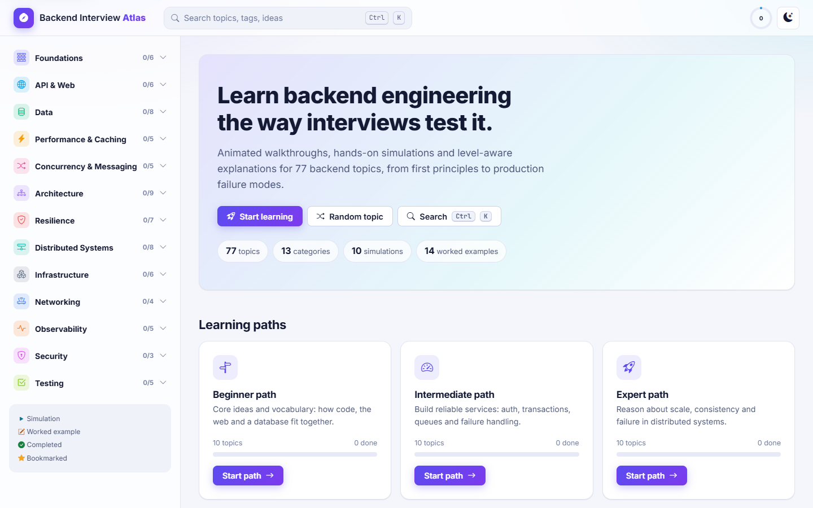
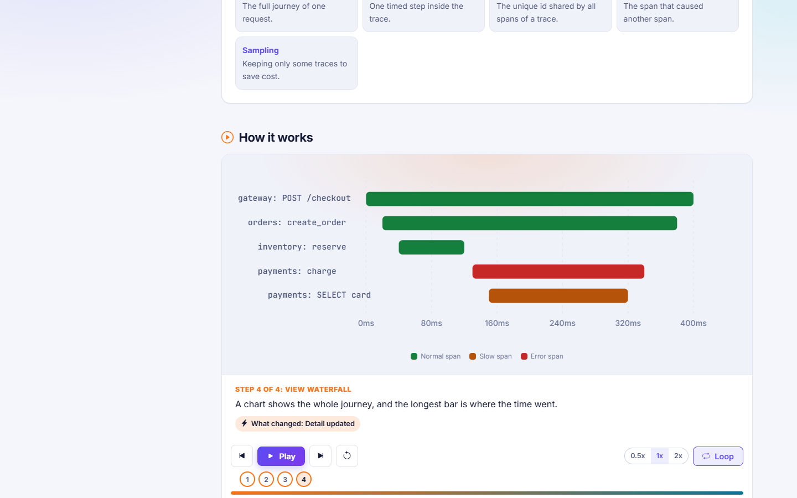
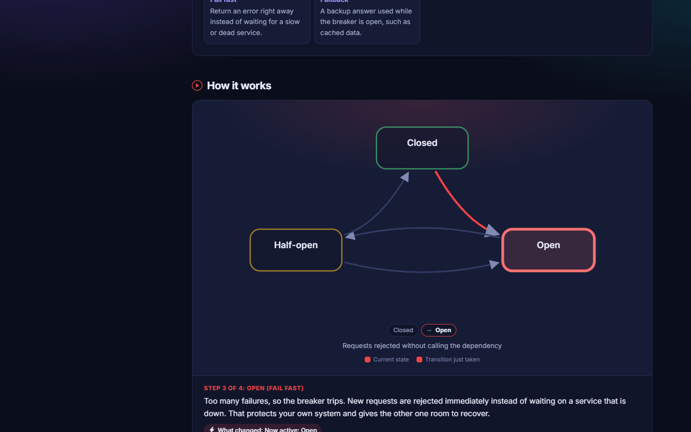
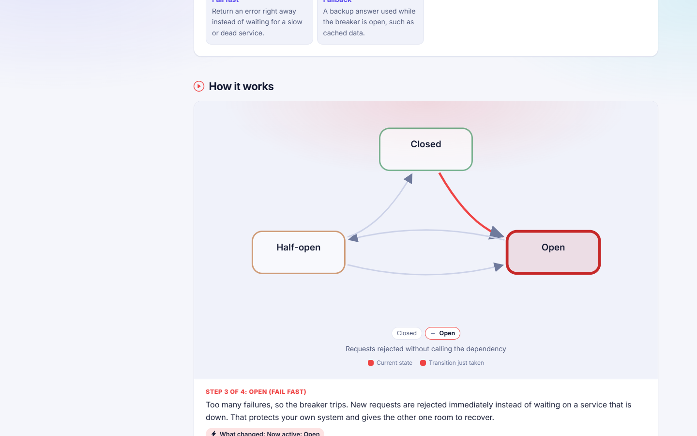
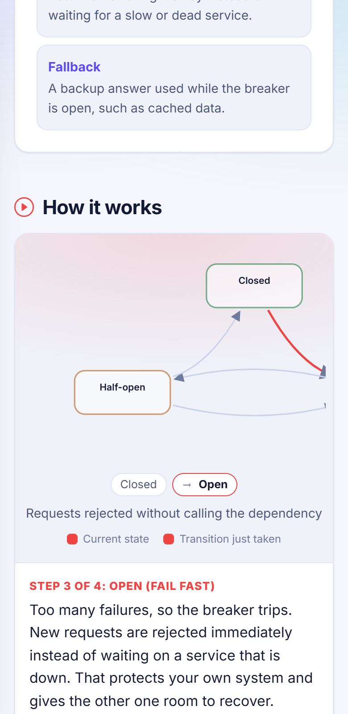
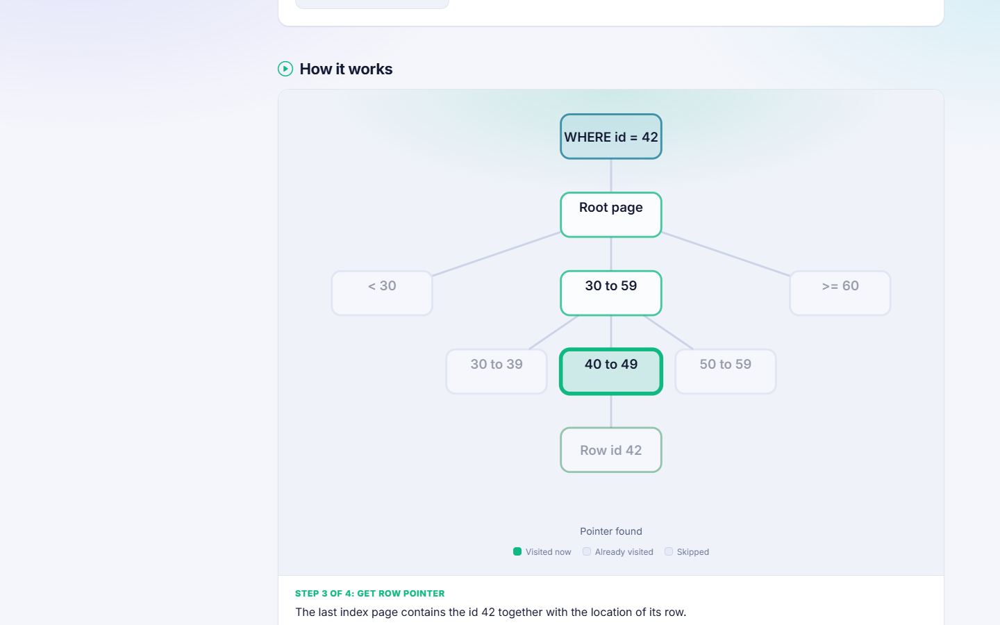

# Backend Interview Atlas

An interactive, visual, beginner-to-expert learning site for backend engineering interviews.
**77 topics, 13 categories, 10 interactive simulations, 14 worked examples**, each explained at three levels (Beginner, Intermediate, Expert) with animated step-by-step visuals, code, interview Q&A and quizzes.

It is plain HTML, CSS and jQuery with no build step. Double-click `index.html` and it runs from `file://`.



## Features

- **Animated "see how it works" visuals.** One stepper (play, pause, step, scrub, speed, keyboard shortcuts) drives 10 renderer types: pipeline, sequence, state machine, topology, timeline/swimlane, data structure, layers, compare, chart and waterfall.
- **Three levels per topic.** Switch between Beginner (real-world analogy, key terms), Intermediate (how it works, trade-offs, pitfalls) and Expert (internals, failure modes, scaling notes, real systems, numbers to know). Captions, visuals, interview questions and quizzes all change with the level.
- **10 hands-on simulations** with sliders, event logs, live metrics and a seeded, deterministic mode: Circuit Breaker, Rate Limiting (token bucket), Caching (LRU), Load Balancing, Retry with Backoff and Jitter, Database Isolation Levels, Indexing, Saga, CAP Theorem, Kafka consumer groups.
- **14 "without the fix vs with the fix" worked examples** in a terminal-style runner with step, pause and side-by-side modes.
- **Code tabs** (Python first, plus SQL, YAML, Bash, JavaScript) with highlight.js, a copy button and line annotations.
- **Interview prep.** Questions with model answers and follow-ups, plus a 4-question quiz per topic with explanations and saved scores.
- **Command palette** (`Ctrl+K`) with fuzzy search across titles, descriptions and tags.
- **Progress tracking** in `localStorage`: completed topics, bookmarks, last visited, level, theme and quiz scores.
- **Light and dark themes**, responsive from 360px to desktop, keyboard accessible, and every animation respects `prefers-reduced-motion`.

| Animated process visual | Dark theme |
|---|---|
|  |  |

| State machine | Mobile (390px) |
|---|---|
|  |  |



## Run it

```text
1. Clone the repo
2. Open index.html in a browser (double-click is enough)
```

An internet connection is needed once for the pinned CDN libraries (jQuery 3.7.1, Bootstrap 5.3, Bootstrap Icons, highlight.js, Inter and JetBrains Mono fonts).

## Topics

| Category | Topics |
|---|---|
| Foundations (6) | Programming language fundamentals, OOP, SOLID, Clean code, Data structures and algorithms, Design patterns |
| API & Web (6) | REST APIs, HTTP/HTTPS, API design and versioning, Authentication and authorization, JWT and OAuth 2.0, Session management |
| Data (8) | SQL, Database design and normalization, Indexing, Transactions and ACID, Isolation levels, Locking, Optimistic and pessimistic concurrency control, NoSQL |
| Performance & Caching (5) | Caching, Redis, Connection pooling, Query optimization, Performance optimization |
| Concurrency & Messaging (5) | Multithreading, Asynchronous programming, Message queues, Kafka and RabbitMQ, Event-driven architecture |
| Architecture (9) | Microservices, Monolith vs microservices, Service-to-service communication, API gateway, Reverse proxy, Load balancing, Rate limiting, Idempotency, Pagination |
| Resilience (7) | Retries and backoff, Circuit breaker, Error handling, Fault tolerance, Health checks, Scalability, High availability |
| Distributed Systems (8) | Distributed transactions, Saga, Two-phase commit, CAP theorem, Consistency models, Replication, Sharding and partitioning, Distributed systems fundamentals |
| Infrastructure (6) | Docker, Kubernetes basics, CI/CD, Git, Linux fundamentals, Cloud fundamentals |
| Networking (4) | Networking fundamentals, DNS, TCP/IP, WebSockets |
| Observability (5) | Logging, Monitoring, Metrics, Distributed tracing, Observability |
| Security (3) | Security best practices, OWASP Top 10, Secrets management |
| Testing (5) | Testing, Unit testing, Integration testing, API testing, Load and performance testing |

## Project structure

```text
index.html
css/   theme.css  layout.css  components.css  visuals.css  animations.css
js/
  core/     app, router, store, theme, search, verify ...
  engine/   stepper, level switcher, visual renderers, sim registry, worked runner, quiz
  sims/     one file per simulation
data/
  meta.js   generated index of all topics
  topics/   one file per topic (each pushes into Atlas.topics)
  worked/   the 14 worked examples
reference/  original single-file Backend_Interview_Atlas.html (source of truth)
docs/       PLAN.md, REMAINING_WORK.md, screenshots/
```

## How it works

- **Data-driven.** Adding a topic means adding data, not rendering code. Each topic is a JS object (see the schema in [docs/PLAN.md](docs/PLAN.md)) with `source`, `visual`, `steps`, `levels`, `sim`, `worked`, `code`, `interview` and `quiz`.
- **No modules, no fetch.** Classic `<script>` tags and a single global namespace, `window.Atlas`, so it works from `file://`.
- **Self-checking.** Open the browser console and run `Atlas.verify()`. It runs 19 checks (topic count, required fields, step and caption coverage, valid prerequisite and related links, registered sims, annotation ranges, no inline styles) and prints how many topics are fully written.

## Add a topic

1. Create `data/topics/<prefix>-<name>.js` following an existing file such as `data/topics/net-dns.js`.
2. Copy `source.description` and `source.steps` verbatim from `data/meta.js`.
3. Add a `<script>` tag in `index.html`.
4. Run `Atlas.verify()` and expect all checks to pass.

## Status

- All 77 topics are authored and `Atlas.verify()` passes 19/19.
- Known gaps and next steps are tracked in [docs/REMAINING_WORK.md](docs/REMAINING_WORK.md). The main ones: more simulations for later categories, a human review of claims marked `// VERIFY`, and a final manual QA pass.

## Tech

HTML5, CSS3, jQuery 3.7.1, Bootstrap 5.3, Bootstrap Icons, highlight.js, Inter and JetBrains Mono.

## There are few more
- https://suprit-kumar.github.io/webapi/
- https://suprit-kumar.github.io/architecture/
- https://suprit-kumar.github.io/concurrency/
- https://suprit-kumar.github.io/performance/
